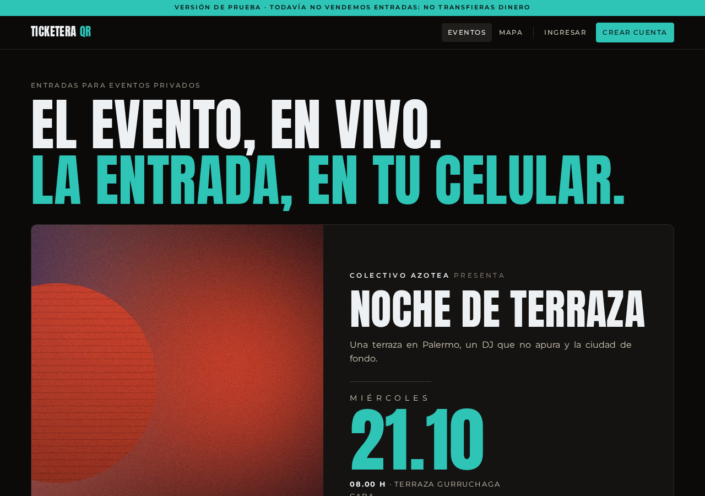
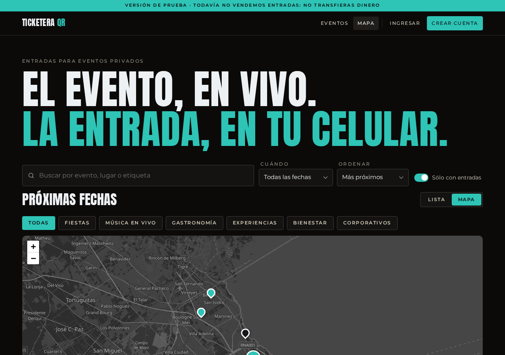
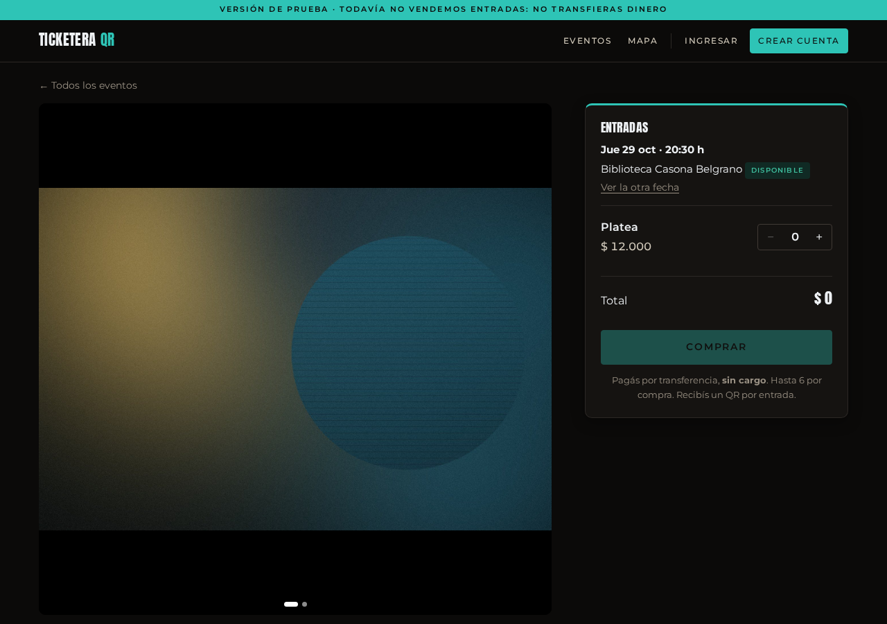
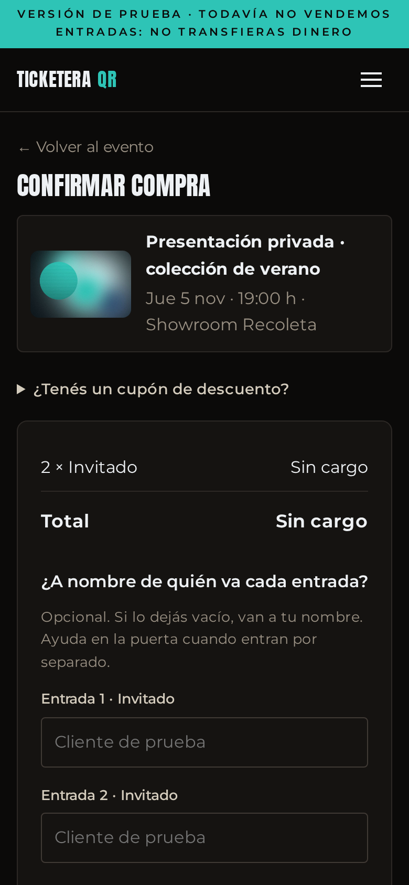
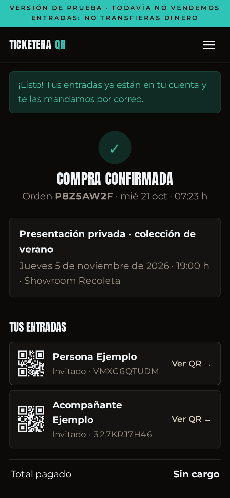
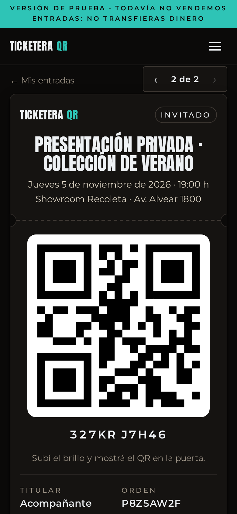
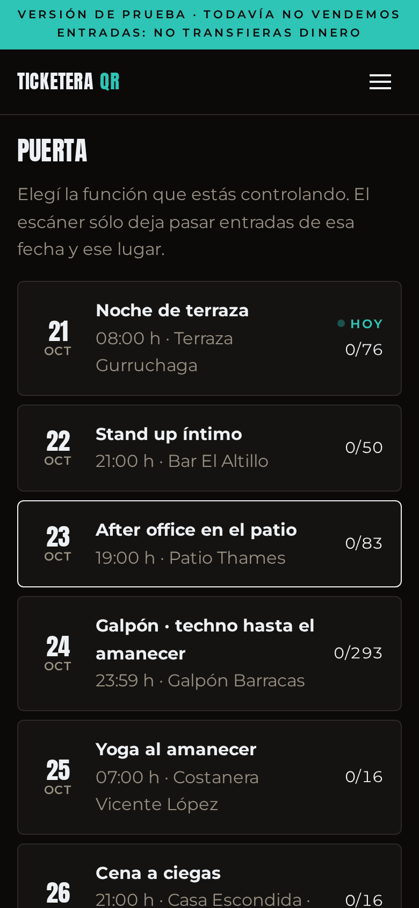
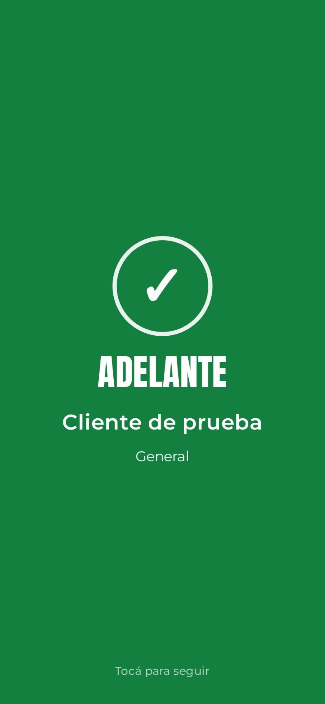
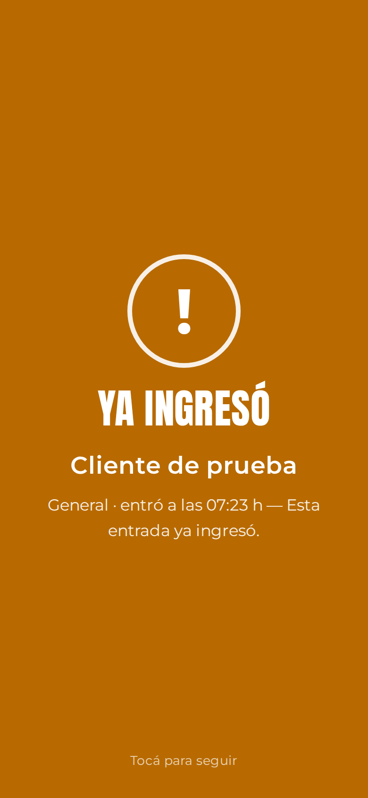

# Ticketera QR




> Proyecto libre de **[DASLATAM](https://github.com/DasLatam)**. Si te sirve,
> dejale una ⭐ al repositorio: es la forma de que más gente lo encuentre.

## Empezar en 3 pasos

```bash
git clone https://github.com/DasLatam/ticketera-qr.git && cd ticketera-qr   # 1. bajarlo (hace falta PHP 8.2+)
php scripts/semilla.php --ejemplo                                  # 2. cargar la demo (imprime 3 usuarios de prueba)
./servir.sh                                                        # 3. levantarlo y abrir http://localhost:8190/
```

En Windows el paso 3 es `php -S 127.0.0.1:8190 -t app app/index.php`.

## Summary

**Ticketera QR** is a small, self-hosted ticketing web app for private events
(dinners, small concerts, workshops, parties). Organizers publish events with
one or more dates and venues; buyers create an account, get one QR code per
ticket (also available offline as an installable PWA) and the door staff scans
them with a phone camera, so each ticket can be used only once. It includes
verified reviews (only people who actually got in can review), discount codes,
bank-transfer payment with receipt upload and in-browser OCR, an optional
reconciliation against a Mercado Pago account, an e-mail queue with per-hour
limits, and a "right of withdrawal" button (Argentine consumer law).
It is plain PHP 8.2 + SQLite, with no framework and no Composer, so it runs on
cheap shared hosting. **Card payment is simulated, not integrated.** The UI and
docs are in Spanish (Argentina).

## Contenido

- [Empezar en 3 pasos](#empezar-en-3-pasos)
- [Qué es](#qué-es)
- [Para quién](#para-quién)
- [Qué hace](#qué-hace)
- [Cómo funciona por dentro](#cómo-funciona-por-dentro)
- [Requisitos](#requisitos)
- [Instalación](#instalación)
- [Uso básico: un ejemplo completo](#uso-básico-un-ejemplo-completo)
- [Configuración](#configuración)
- [Publicarlo en un hosting compartido](#publicarlo-en-un-hosting-compartido)
- [Preguntas frecuentes](#preguntas-frecuentes)
- [Limitaciones](#limitaciones)
- [Privacidad](#privacidad)
- [Avisos legales](#avisos-legales)
- [Cómo contribuir](#cómo-contribuir)
- [Licencia y créditos](#licencia-y-créditos)

## Qué es

Una ticketera propia para vender entradas de eventos privados y controlar el
ingreso con el celular: cada entrada es un QR que se «quema» una sola vez en la
puerta.

## Para quién

Para quien organiza eventos chicos o medianos (un ciclo de música, cenas, talleres,
fiestas, presentaciones por invitación) y prefiere tener su propia plataforma en
vez de pagar comisión por entrada a una ticketera grande. Hay tres roles:

| Rol | Qué hace |
|---|---|
| Cliente | Busca eventos (lista o mapa), compra, recibe un QR por entrada, opina después de asistir |
| Puerta | Elige la función y escanea los QR con la cámara; cada entrada entra una sola vez |
| Administración | Eventos, funciones, precios, cupones, imágenes, ventas, asistentes, reseñas, usuarios, cobros y correo |

## Qué hace

Todas las capturas son de esta misma copia corriendo en local con los datos de
ejemplo que trae (`scripts/semilla.php --ejemplo`): eventos, lugares, personas
y fotos son inventados.

**Catálogo** con buscador, filtros por categoría, fecha y etiqueta, y el próximo
evento destacado. Los filtros aparecen solos cuando hay más de seis eventos.


**Mapa** con los mismos filtros (OpenStreetMap + Leaflet, sin claves).



**Ficha del evento**: galería, fechas y lugares, tipos de entrada con precio,
oferta por tiempo, «cómo llegar», compartir y reseñas verificadas.



**Compra con QR**: titular por entrada, control de stock sin sobreventa (la
compra toma un candado de la base antes de releer el stock), un QR por entrada
y «Mis entradas». La entrada se guarda en el celular y se puede mostrar sin señal.

| Checkout | Compra confirmada | La entrada |
|---|---|---|
|  |  |  |

**Puerta**: la persona de puerta elige la función y escanea con la cámara del
celular (o tipea el código). Pantalla completa verde/roja, sonido, vibración,
contador de ingresados y registro de cada lectura. La misma entrada leída dos
veces rebota con «Ya ingresó».

| Funciones de hoy | Entrada válida | La misma, otra vez |
|---|---|---|
|  |  |  |

Además:

- **Evento y funciones**: un evento (textos, imágenes, categoría, reseñas) tiene
  una o más funciones, cada una con fecha, lugar, coordenadas, aforo y tipos de
  entrada. Un ciclo que se repite suma todas sus reseñas en un solo evento.
- **Reseñas verificadas**: sólo opina quien pasó por la puerta, una vez por
  función, y la reseña dice a qué fecha fue. El administrador oculta, no borra.
- **Cupones** (% o monto fijo, por evento o para todos, con tope de usos y
  vencimiento) y **precio de oferta** hasta una fecha.
- **Pago por transferencia**: la compra reserva los lugares, la persona sube la
  foto o el PDF del comprobante, y el panel lo lee con OCR en el navegador
  (Tesseract.js / pdf.js) para marcar si coincide el monto y el código de la
  orden. Quien confirma es una persona.
- **Conciliación con Mercado Pago (opcional)**: con un token de la cuenta donde
  te transfieren, cruza el comprobante con los pagos que entraron y confirma
  sola cuando la prueba es fuerte (número de operación, código de orden, DNI).
  No es cobrar con Mercado Pago: es leer la cuenta.
- **Correo** con cola, plantillas HTML con el QR incrustado, y topes por hora,
  día, semana y mes para no pasarse de los límites del proveedor.
- **«No soy un robot» propio** (prueba de trabajo + campo trampa), sin claves
  de terceros ni cookies.
- **Aplicación instalable (PWA)** con instructivo para iPhone y Android, tema
  claro/oscuro y textos legales de ejemplo (Condiciones, Privacidad, Cookies).
- **Botón de arrepentimiento** (10 días corridos desde que recibe la entrada y
  hasta 24 h antes de la función) con código de trámite y bandeja de reintegros.

## Cómo funciona por dentro

```
 navegador (cliente / puerta / admin)
        │  HTML + CSS + JS propios; QR y escáner en el navegador
        ▼
 app/index.php ── controlador frontal: una tabla de rutas → funciones
        │
        ├── app/nucleo/   lógica (base, compras, puerta, correo, cupones,
        │                 transferencias, Mercado Pago, captcha, admin)
        ├── app/vistas/   plantillas PHP
        └── app/estaticos/ CSS, JS, Leaflet, jsQR, fuentes (todo local)
        │
        ▼
 datos/  (FUERA de la carpeta pública)
   base.sqlite · comprobantes/ · secretos.php · captcha.key · sesiones/
```

- PHP sin framework y SQLite. Los cambios de esquema van en `MIGRACIONES`
  (`app/nucleo/base.php`) y se aplican solos en el primer pedido; una base nueva
  sale completa de `app/nucleo/esquema.sql`.
- **Evento ≠ función**: entradas, órdenes, escaneos y reseñas cuelgan de la función.
- La puerta «quema» con `UPDATE … WHERE estado='valida'`: dos lectores a la vez
  no dejan pasar la misma entrada dos veces.
- Los correos se mandan al terminar el mismo pedido que los genera (después de
  responderle al navegador) y lo que falla lo reintenta la próxima visita o
  la tarea programada (`app/nucleo/cron_correos.php`).

## Requisitos

- **PHP 8.2 o más nuevo** con las extensiones `pdo_sqlite`, `gd` (con JPEG),
  `mbstring`, `fileinfo`, `openssl` y `curl` (sólo para Mercado Pago). `exif`
  es opcional (endereza fotos de celular).
- Nada más: no hace falta Composer, Node, ni un servidor de base de datos.
- Para publicarlo: un hosting con Apache y PHP 8.2 (sirve el compartido más
  barato) o cualquier servidor con PHP-FPM.

## Instalación

Los pasos son los mismos en los tres sistemas; cambia cómo se instala PHP.

### 1. Instalar PHP

- **Windows**: bajá el ZIP «VS16 x64 Thread Safe» de
  [windows.php.net/download](https://windows.php.net/download/), descomprimilo
  en `C:\php`, copiá `php.ini-development` como `php.ini` y sacale el `;` del
  principio a las líneas `extension=pdo_sqlite`, `extension=gd`,
  `extension=mbstring`, `extension=fileinfo`, `extension=openssl` y
  `extension=curl`. Sumá `C:\php` al PATH.
- **macOS**: con [Homebrew](https://brew.sh), `brew install php`.
- **Linux (Debian/Ubuntu)**: `sudo apt install php-cli php-sqlite3 php-gd php-mbstring php-curl`.

Comprobá en una terminal:

```
php -v
```

Tiene que decir `PHP 8.2` o un número mayor.

### 2. Bajar el código

Con git (`git clone https://github.com/DasLatam/ticketera-qr.git ticketera-qr`) o bajando el ZIP del
repositorio y descomprimiéndolo. Entrá a la carpeta:

```
cd ticketera-qr
```

### 3. Cargar los datos de ejemplo

```
php scripts/semilla.php --ejemplo
```

Se debería ver algo así (las claves cambian cada vez):

```
ADMIN_EMAIL=admin@demo.invalid
ADMIN_CLAVE=Clave-XXXX-XXXX
PUERTA_EMAIL=puerta@demo.invalid
PUERTA_CLAVE=Clave-XXXX-XXXX
CLIENTE_EMAIL=cliente@demo.invalid
CLIENTE_CLAVE=Clave-XXXX-XXXX
Listo: 14 eventos, 37 funciones, 71 clientes, 865 compras, 1883 entradas, 128 reseñas.
Credenciales en .../datos/credenciales.env
```

Esas tres cuentas son para probar; quedan anotadas en `datos/credenciales.env`.

### 4. Levantarlo

- **macOS / Linux**: `./servir.sh`
- **Windows** (o cualquier sistema): `php -S 127.0.0.1:8190 -t app app/index.php`

Abrí **http://localhost:8190/** en el navegador. Arriba vas a ver la franja
«Versión de prueba»: es el modo prueba, que no manda correos.

Para probar la puerta con un celular de tu misma red WiFi, levantalo con
`HOST=0.0.0.0 ./servir.sh` y entrá desde el celular a `http://<ip-de-tu-compu>:8190/`.
Ojo: los navegadores sólo dejan usar la cámara en `https` o en `localhost`;
desde otra máquina por `http` la puerta funciona con el código tipeado a mano.

## Uso básico: un ejemplo completo

1. Entrá con la cuenta **cliente** (`/ingresar`), abrí un evento, elegí fecha y
   cantidad y tocá **Comprar**.
2. Completá el titular de cada entrada, aceptá las condiciones y confirmá. Con un
   evento sin cargo la compra queda confirmada al instante; con transferencia,
   queda reservada hasta que subas un comprobante (en modo prueba sirve
   cualquier imagen, por ejemplo `semilla/comprobante-ejemplo.jpg`).
3. En **Mis entradas** tocá una y vas a ver el QR.
4. En otra ventana privada, entrá con la cuenta **puerta**, abrí **Puerta**,
   elegí la función de hoy y escaneá el QR (o tipeá el código). Sale verde,
   «Adelante». Si la volvés a leer, sale «Ya ingresó».
5. Con la cuenta **admin**, en **Administración** aprobás transferencias, ves
   ventas y asistentes, creás eventos, funciones, precios y cupones.

Para empezar de verdad, sin los ejemplos:

```
php scripts/semilla.php --vacio --email tu-correo@tu-dominio --nombre "Tu nombre"
```

Borra todo y deja sólo tu usuario administrador (la clave se muestra en
pantalla y queda en `datos/credenciales.env`; cambiala desde **Mi cuenta**).

## Configuración

Copiá `config.example.php` como `config.local.php` (al lado de `app/`) y
editalo. Lo que no definas toma el valor por defecto.

| Constante | Por defecto | Para qué |
|---|---|---|
| `APP_NOMBRE` | `Ticketera QR` | Nombre en la cabecera, correos y app instalable (la última palabra va en el color de acento) |
| `ORGANIZADOR` | vacío | Quién produce los eventos; aparece en portada, pie y como organizador por defecto |
| `ORGANIZADOR_URL` | vacío | Enlace a su sitio o red social |
| `URL_PUBLICA` | `http://localhost:8190` | Dirección pública, sin barra final (correos, metadatos, sitemap) |
| `ZONA_HORARIA` | `America/Argentina/Buenos_Aires` | Zona horaria de las funciones |
| `MODO_DEMO` | `true` | Modo prueba: franja de aviso, sin correos, noindex. En `false` exige https |
| `DIR_DATOS` | `datos/` | Base, comprobantes y secretos. Siempre fuera de la carpeta pública |
| `CORREO_CONTACTO` | `contacto@example.com` | Remitente de los correos y contacto de los textos legales |
| `SMTP_HOST` / `SMTP_PUERTO` | `smtp.example.com` / `465` | Servidor de correo saliente (SSL) |
| `CORREO_TOPES` | 100/h, 800/día, 4000/semana, 15000/mes | Límites de envío de tu proveedor |

Los secretos van aparte, en `datos/secretos.php` (modelo: `secretos.example.php`):

| Constante | Para qué |
|---|---|
| `SMTP_CLAVE` | Contraseña de la casilla `CORREO_CONTACTO` |
| `TAREA_CLAVE` | Opcional: habilita `/tarea/correos?clave=…` para despachar correos desde un cron con `curl` |

Desde el panel (**Administración › Cobro**) se cargan los datos de la cuenta
para transferencias (alias, CBU/CVU, titular) y, si querés, el token de Mercado
Pago para la conciliación. Esas credenciales quedan en `datos/mercadopago.json`.

Para cambiar colores, editá las variables de `:root` al principio de
`app/estaticos/app.css`. La imagen para compartir y los íconos se regeneran con
`python3 scripts/generar_marca.py "Tu nombre"` (necesita Pillow).

## Publicarlo en un hosting compartido

1. Subí el **contenido de `app/`** a la carpeta pública del dominio (por ejemplo,
   `public_html/`). El `.htaccess` que trae manda todo a `index.php` y bloquea
   `nucleo/` y `vistas/`.
2. Creá una carpeta de datos **fuera** de la pública (por ejemplo,
   `/home/tu-usuario/datos-ticketera/`) y subí ahí tu `secretos.php`.
3. Subí `config.local.php` a la carpeta que contiene a la pública (la app lo
   busca un nivel arriba de `app/`; si `app/` es `public_html/`, va en la carpeta
   de tu usuario) con `MODO_DEMO = false`, tu `URL_PUBLICA` con `https://`, tu
   casilla y `DIR_DATOS` apuntando a la carpeta del paso 2.
4. Generá la base en tu computadora con `semilla.php --vacio` y subí
   `datos/base.sqlite` a la carpeta de datos, o dejá que se cree sola en el
   primer pedido (en ese caso, creá el administrador con `--vacio` por consola
   SSH si tu hosting la tiene).
5. Activá **https** (Let's Encrypt suele venir con el panel). Sin https, en
   `MODO_DEMO = false` no se puede iniciar sesión (la cookie es `secure`).
6. Opcional: una tarea programada cada 15 minutos con
   `php /ruta/a/public_html/nucleo/cron_correos.php`, o, si el `php` de la
   consola es viejo, `curl -s "https://tu-dominio/tarea/correos?clave=<TAREA_CLAVE>"`.
7. Editá `robots.txt` (la URL del sitemap) y revisá los textos legales en
   `app/vistas/legal/`: son un punto de partida, no asesoramiento legal.

Cada vez que publiques una versión nueva podés escribir la fecha y el commit en
`app/version.txt`: va en la URL de cada CSS/JS y en el service worker, así los
navegadores renuevan todo.

## Preguntas frecuentes

**¿Cobra con tarjeta?** No. El botón de tarjeta existe pero el pago es
**simulado**: en modo prueba confirma sin cobrar y fuera del modo prueba está
apagado a propósito. El medio real es la transferencia con comprobante. En
`/admin/pagos` hay una propuesta de cómo integrar Mercado Pago Checkout Pro.

**¿Hace falta Mercado Pago?** No. La transferencia funciona sola: el comprador
sube el comprobante y una persona confirma. Mercado Pago sólo agrega la
conciliación automática si te transfieren a una cuenta de Mercado Pago.

**¿Funciona sin señal en la puerta?** La entrada del comprador sí: si la abrió
una vez con red, queda guardada en el celular. El escáner de la puerta
necesita red para validar contra la base.

**¿Puedo tener varios organizadores?** Cada evento tiene su campo «organizador»,
pero hay un solo panel de administración: no es una plataforma multi-cliente.

**¿Por qué SQLite?** Porque corre en cualquier hosting sin crear una base y
alcanza de sobra para el volumen de eventos privados. Se respalda copiando un archivo.

## Limitaciones

- **El pago con tarjeta es simulado.** No hay integración de cobro real.
- La conciliación con Mercado Pago se probó con transferencias reales, pero la
  documentación oficial no describe cómo llegan las transferencias por alias/CVU;
  puede cambiar sin aviso.
- La lectura de comprobantes (OCR) carga Tesseract.js y pdf.js desde jsDelivr y
  cdnjs: el panel necesita internet para eso. HEIC (fotos de iPhone) no se lee.
- Sin butacas numeradas, sin listas de invitados por RRPP, sin multi-organizador.
- Interfaz sólo en castellano (Argentina): pesos, CBU/CVU, Ley de Defensa del Consumidor.
- Los textos legales y los plazos del botón de arrepentimiento son una base
  que tiene que revisar un abogado para tu caso.
- Sin tests automáticos.

## Privacidad

- Guarda lo que necesita una ticketera: nombre, correo, teléfono opcional, compras,
  titulares de entradas, comprobantes de pago y lecturas de la puerta. Todo en
  tu servidor, en la carpeta de datos fuera de la parte pública.
- Una sola cookie (la sesión). Sin analítica ni rastreadores; las fuentes van
  incluidas, no se piden a Google.
- Servicios externos que usa el navegador: teselas de OpenStreetMap (mapa),
  jsDelivr y cdnjs (sólo el OCR del panel). La geocodificación de direcciones
  (Nominatim) se hace a pedido desde el navegador del administrador.
- Los datos de ejemplo usan el dominio reservado `@demo.invalid`: la cola de
  correo los descarta sin intentar.

## Avisos legales

- Mercado Pago, WhatsApp, Instagram, TikTok, X, Google Maps, Waze y
  OpenStreetMap son marcas de sus dueños. Este proyecto no está afiliado ni
  respaldado por ninguno. Los botones de compartir sólo abren los enlaces públicos
  de cada red.
- Las imágenes de los eventos de ejemplo se generan con
  `scripts/generar_fotos_ejemplo.py` (manchas de color, sin fotos de terceros).
- Respetá la [política de uso de las teselas de OpenStreetMap](https://operations.osmfoundation.org/policies/tiles/)
  y la de [Nominatim](https://operations.osmfoundation.org/policies/nominatim/):
  para mucho tráfico conviene un proveedor de teselas propio.

## Cómo contribuir

Ver [CONTRIBUTING.md](CONTRIBUTING.md). Para reportar una falla de seguridad,
[SECURITY.md](SECURITY.md).

## Licencia y créditos

Código bajo **GNU AGPL-3.0 o posterior** ([LICENSE](LICENSE)): podés usarlo,
modificarlo y ofrecerlo como servicio, pero si lo modificás y lo ponés en línea
tenés que ofrecer el código de tu versión a sus usuarios.

Usa, incluidos en el repositorio, componentes de terceros con sus propias
licencias (detalle en [TERCEROS.md](TERCEROS.md)): PHPMailer (LGPL-2.1),
chillerlan/php-qrcode y php-settings-container (MIT), Leaflet (BSD-2-Clause),
Leaflet.markercluster (MIT), jsQR (Apache-2.0), QR Code Generator de Kazuhiko
Arase (MIT) y las tipografías Anton y Montserrat (SIL OFL 1.1). Tesseract.js y
pdf.js (Apache-2.0) se cargan desde CDN.

© The ticketera-qr contributors.

Desarrollado y mantenido por **[DASLATAM](https://github.com/DasLatam)**.
Las contribuciones son bienvenidas: ver [CONTRIBUTING.md](CONTRIBUTING.md).
